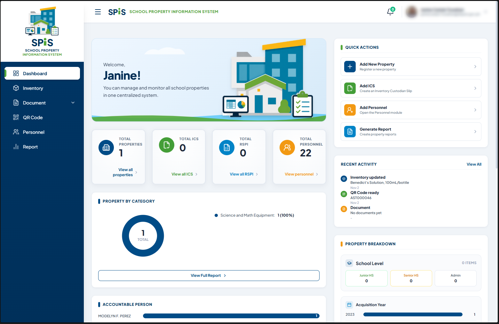

<div align="center">


# School Property Information System (SPIS)

### A centralized platform for school property and inventory management

<p>
  
  
  
  
</p>

</div>

---

## 🖥️ SPIS Dashboard

<p align="center">
  
</p>

<p align="center"><em>The School Property Information System dashboard</em></p>

## 📌 About SPIS

The **School Property Information System (SPIS)** is a web-based application designed to help schools organize, monitor, and manage property information in one centralized system. It supports property recordkeeping and related inventory workflows, with reporting and document tools for easier information retrieval.

## ✨ Key Modules

| Module | Description |
|---|---|
| **Dashboard** | Overview of property records, inventory activity, and summary information |
| **Inventory** | Register and manage school property and asset records |
| **Documents** | Access property-related forms and documents |
| **QR Code** | QR code generation and property identification |
| **Personnel** | Manage personnel records associated with property accountability |
| **Reports** | Generate property and inventory reports |

## 🧰 Technology Stack

- **Frontend:** HTML, CSS, JavaScript
- **Server:** Node.js, Express
- **Database / Backend services:** Supabase
- **Additional integration:** Google Apps Script

## 🚀 Getting Started

### Prerequisites

- [Node.js](https://nodejs.org/) (LTS recommended)
- npm
- A configured [Supabase](https://supabase.com/) project

### 1. Clone the repository

```bash
git clone https://github.com/corbis13/School-Property-Information-System.git
cd School-Property-Information-System
```

### 2. Install dependencies

```bash
npm install
```

### 3. Configure environment variables

Copy `.env.example` to `.env` and configure the values required by your local setup.

```env
SUPABASE_URL=your_supabase_project_url
SUPABASE_ANON_KEY=your_supabase_anon_key
```

**Security:** Never commit real credentials, Supabase service-role keys, or secrets. Keep private environment files out of version control.

### 4. Run the application

```bash
npm run dev
```

Use the local URL shown in your terminal.

## 🗄️ Database Setup

Database setup and configuration resources are available in the application directory. Review the SQL scripts and Row Level Security (RLS) policies before applying them to your Supabase project.

- Apply only the SQL appropriate for your environment.
- Enable and test RLS on tables exposed through the API.
- Follow least-privilege access policies.
- Never expose a service-role key in browser-side code.

## 📂 Project Structure

```text
.
├── docs/
│   └── screenshots/
│       └── spis-dashboard.png   # Application dashboard preview
├── SchoolPropertyInventorySystem/
│   ├── images/                  # SPIS logo and application assets
│   ├── css/                     # Stylesheets
│   ├── js/                      # Frontend scripts
│   ├── reports/                  # Report pages and resources
│   ├── index.html               # Application entry page
│   ├── homepage.html             # Dashboard / homepage
│   ├── server.js                 # Application server
│   └── supabase-setup.sql        # Database setup
├── .env.example
├── package.json
└── README.md
```

## 🛣️ Roadmap

- [ ] Complete and refine property inventory workflows
- [ ] Improve reporting and property document management
- [ ] Strengthen authentication and Row Level Security
- [x] Add SPIS dashboard screenshot to project documentation

## 🤝 Contributions & Feedback

Suggestions, bug reports, and improvements are welcome. Please provide clear steps to reproduce issues and describe expected behavior.

## 📄 License

A license has not yet been specified. All rights remain reserved unless a license is added to this repository.

---

<div align="center">

**School Property Information System (SPIS)**

*Organizing school property information—one system at a time.*

</div>
